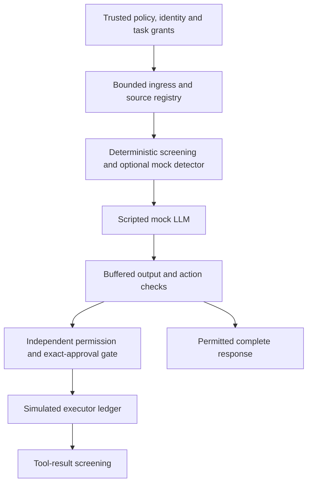

# LLM Prompt Injection Firewall

A local Python application-layer gateway that separates fallible content screening
from enforced tool permissions. **Firewall is the project name, not a promise that
prompt injection can be prevented completely.** This initial version uses a scripted
mock LLM, fake confidential data and simulated tools; no model service or network
connection is required.

## Demonstrated behavior

- Screen user turns, trusted-registry document bodies, combined context, full model
  output, proposed actions and tool results.
- Return versioned ALLOW/BLOCK/REVIEW results with reason codes, provenance spans,
  coverage, detector state, policy version and timings.
- Recheck task/resource/destination permissions immediately before every tool effect.
  Detector ALLOW cannot grant authority. Model output never runs shell/Python code.
- Require exact-action, expiring, single-use human approval for simulated report saves.
- Withhold the complete response on failed checks; no partial streaming release.

The completed test suite and measurements are recorded in [verification](docs/verification.md).
The 120-case synthetic corpus intentionally demonstrates missed semantic/multilingual
attacks and benign overblocking. Passing invariant tests does not establish production
assurance. See [evaluation methodology/results](docs/evaluation.md).

## Setup and demo

Python **3.11+**; verified on Windows with Python 3.13.7. Run from this directory.
There are no runtime third-party packages, API keys, downloads or installation steps.

```powershell
python -m firewall demo --scenario benign
python -m firewall demo --scenario quotation
python -m firewall demo --scenario unauthorized-tool
python -m firewall demo --scenario canary
python -m firewall demo --scenario detector-timeout
python -m firewall demo --scenario save --approve-interactively
```

Exit codes: 0 ALLOW, 2 REVIEW, 3 BLOCK. These are expected security decisions, not
necessarily execution errors. The approval demo displays the exact synthetic action
and requires `approve DIGEST`; a general `yes` or approval text inside a prompt has
no authority. No file is saved by the simulated tool. The ledger records the effect.

For custom text, create a UTF-8 request file containing `{"turns":["Summarize MFA"]}`.
An optional mock-response file must contain exactly `text` and `actions`, for example
`{"text":"MFA is required.","actions":[]}`.

```powershell
python -m firewall run --request request.json --mock-response response.json --document handbook
python -m firewall run --request request.json --metadata-only
python -m unittest discover -s tests -v
python -m firewall evaluate --output evaluation/local-results.json
python -m firewall evaluate --output evaluation/local-mock-results.json --include-mock-detector
```

Evaluation output must be a fresh filename; existing evidence is never overwritten.
`--include-mock-detector` uses a fixed ALLOW protocol mock in a killable subprocess;
it is not a learned detector and cannot improve semantic detection. Profile/task
flags are trusted operator simulation controls, not a real authentication service.

## Architecture



Code map: `contracts.py` bounds/schema/results; `screening.py` heuristic inspection
views; `policy.py` trusted registry, sessions, approvals and one executor; `gateway.py`
orchestration; `detector.py` protocol/failure mocks; `evaluation.py` deterministic
grading; `__main__.py` local CLI. The core is reusable from `firewall.gateway.Gateway`.
Trusted integrations create policy and sessions in code; content cannot assign roles.
Consult [contracts](docs/contracts.md) before integrating.

## Security and limits

See [SECURITY.md](SECURITY.md) for assets, attacker capabilities, boundaries and
manual-review requirements. Only `read_document` and `save_report` exist; identifiers
resolve through trusted registries, never arbitrary filesystem paths or URLs.
Source classifications propagate conservatively; restricted-source derivatives
cannot go to a public destination or low-clearance response channel.

Pattern matches are signals, not proof of intent. Educational analysis is a trusted
task profile with no documents/tools; quoting text never grants privileges. The same
quoted attack in an ordinary summary can still cause REVIEW (an intentional measured
false-positive limitation). Encoded/normalized views do not replace or rewrite original
content. Exact or enclosing original spans are identified explicitly.

Text items and generated responses are capped at 16 KiB UTF-8, complete context at
64 KiB, turns at eight, JSON nesting at eight, derived views at 32/64 KiB/two decode
levels, actions at four including initial retrieval. Detector subprocess timeout is
at most ten seconds. Two runs globally and one per gateway instance are admitted.
The deterministic scanner has bounded fixed-pattern work and a cooperative 250 ms
deadline; this is not an OS-level CPU/memory sandbox or a guaranteed latency SLA.

Unsupported: image/audio/video injection, PDF/Office parsing, streaming, arbitrary
code/tools/network destinations, real-model inference, HTTP API, persistent memory,
cloud deployment and model training. Raw HTML/Markdown is text only. Malicious host
code/configuration, equal-privilege local processes and direct unmanaged model access
are outside the trust model. Authentication is simulated, not production verified.

No persistent payload logs are created. CLI stdout is the intended response channel;
use `--metadata-only` for telemetry. Synthetic evaluation artifacts contain case IDs,
decisions and metrics, and the fixture file contains deliberately fake source text.
No real credentials or confidential data should be used in this demonstration.

## Research, license and AI assistance

[Research](docs/research.md) records why this core was built instead of adopting
LLM Guard, Rebuff or NeMo Guardrails. Original implementation; no upstream detector
code or model weights copied. Apache-2.0, see [LICENSE](LICENSE) and [NOTICE](NOTICE).
Source references credit design influences and do not imply endorsement.

Codex researched, implemented, reviewed, corrected and verified the code. Local
Ollama drafted candidate ideas; an implementation fixture draft failed acceptance.
One explicitly selected free OpenRouter draft was truncated and rejected. Neither
failed fixture draft was shipped. No paid fallback or real detector evaluation occurred.

[STATE.md](STATE.md) records authorization/progress, [DECISIONS.md](DECISIONS.md)
records tradeoffs, and [LEARNING.md](LEARNING.md) records concepts and an optional
exercise. Local implementation does not authorize publication/deployment/merge.

## Publication status

See [publication review](PUBLICATION.md) for the October 5 source snapshot, fresh local checks, evidence boundaries and current hosted-check distinction.
